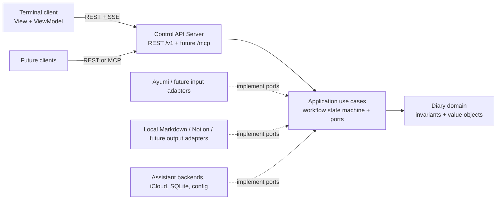

# Architecture

Status: Active

The application runs a local Control API Server that owns diary workflows and
exposes them to independent clients. A terminal client is the first interface;
source and destination connectors keep diary policy independent of particular
files, cloud services, and user interfaces.

## Architectural decisions

| Concern | Decision |
|---|---|
| Client and server | A single per-user server process owns workflow state, the private database, credentials, connectors, and side effects. A human starts it manually with `nd serve`; the TUI never spawns it and communicates with it over loopback HTTP like any other client. |
| Binary name | The canonical project acronym is `nd`, always lowercase. The application is the single binary `nd`; `nd serve` is its server subcommand and `nd` alone opens the TUI. |
| Clean architecture | Domain policy and use cases depend on inward-facing types and ports. HTTP, Ratatui, macOS frameworks, SQLite, and Notion live in adapters that depend on the core. |
| MVVM | The TUI ViewModel turns API representations and event notifications into screen state; the View renders it and sends user intent back through the API client. The server remains the source of truth. |
| Pipeline | One explicit, resumable workflow state machine orders discovery, selection, composition, confirmation, and publication. Each step has typed inputs, outputs, and invalidation rules. |
| Connectors | Registered input and output connectors implement capability-focused ports. Their identifiers and opaque source or destination keys cross the API; a separate safe local source-note name supports presentation. Vendor objects and absolute filesystem paths do not become core types. |
| Platform bridge | iCloud downloads and coordinated reads are Foundation APIs, and Apple's Foundation Models API for the optional on-device model is Swift-only. The server reaches both through one Swift helper process that speaks a versioned protocol over standard input and output. The core sees only the `DraftAssistant` and `SourceReader` ports. |
| Composition and egress | One `DraftAssistant` port supports a registry of backend adapters rather than a fixed two-case branch. Phase 1's hosted default is OpenAI's Codex, reached through the `codex app-server` JSON-RPC surface (not the Codex SDK, which is TypeScript-only and unreachable from Rust, and not raw `codex exec` CLI flags, which cannot restrict which paths a command may read). One registry member is assembled per configured Codex profile/`codex_home`; a fresh `codex app-server` child process is spawned per assistant job and killed afterward, so `CODEX_HOME` isolation and cancellation stay process-scoped rather than shared across jobs. Each `turn/start` sets a restricted `sandboxPolicy` (`readOnly`, `networkAccess: false`), and each job's `thread/start` scopes `cwd` to a freshly created, empty, owner-only directory removed when the job ends — the app-server's `sandboxPolicy.access`/`readableRoots` restriction was removed upstream, so confinement now also relies on nothing reachable existing to read rather than on a zero-root sandbox flag. The launch also sends `-c mcp_servers={}` and `-c web_search="disabled"` to disable all MCP servers and web search, sets the approval policy to never block on a human, and disables local history/rollout persistence, so no diary text reaches disk inside `codex_home` and no tool exists for the model to call. **Known gap:** on `codex-cli` 0.165.0, `-c mcp_servers={}` does not actually clear a profile's `config.toml`-defined `[mcp_servers.*]` entries — they still start for every turn. See [milestone-08's acceptance notes](phase-1/milestone-08-draft-assistants-overview.md) for the confirmed reproduction; this needs its own fix before the "no MCP servers" guarantee can be considered restored. Phase 1 also supplies an optional Apple on-device backend; another approved adapter can register without changing workflow policy or the TUI layout. Each assistant action targets exactly one backend. Only readable note bodies, memories, drafts, the edited entry, and writing settings can reach a hosted backend; front matter, attachment paths, audio, credentials, and the Notion root cannot be expressed in the port's types. See [Assistant backend registry](#assistant-backend-registry) and [Hosted drafting and data egress](#hosted-drafting-and-data-egress). |
| Concurrency | The server's HTTP and event layer is async on Tokio. Blocking work (SQLite, file hashing, helper pipes) runs on bounded workers with timeouts and cancellation. The TUI keeps a synchronous event loop with bounded worker threads. |
| HTTP surfaces | `/v1` is a versioned JSON REST API with a separate Server-Sent Events (SSE) change stream. The same listener can later mount `/mcp` as an MCP Streamable HTTP endpoint; that protocol is distinct from the REST API. |

This adapts the inward dependency rule from [Clean Architecture](https://blog.cleancoder.com/uncle-bob/2012/08/13/the-clean-architecture.html)
and the adapter boundary from the original [ports and adapters description](https://alistair.cockburn.us/hexagonal-architecture).
The rule concerns source-code dependencies, not the direction of a request at
runtime. The core defines the conversations it needs; outer modules implement
them and are assembled at startup.

## System context and dependency direction



Request flow goes from clients toward the server and then through use cases.
Source-code imports point toward the domain and application boundary: domain
imports nothing outward; use cases import domain; adapters and transports import
the core. HTTP handlers translate wire DTOs and errors but do not decide source
eligibility, approve text, or infer whether a publication succeeded. The TUI
never reads the SQLite database or calls Notion or model APIs directly.

Proposed Rust workspace boundaries are:

```text
crates/diary-core/              domain, use cases, ports, state transitions
crates/diary-connectors/        Ayumi, local Markdown, Notion, hosted draft, Apple, SQLite, macOS
crates/diary-control-contract/  versioned wire DTOs and API schema
crates/diary-control/           Control API Server, REST, SSE, future MCP adapter
crates/diary-tui/               typed HTTP client, ViewModels, views, terminal, IME indicator
helpers/apple-bridge/           Swift helper executable for iCloud and the optional Foundation Models
apps/nd/                        startup, connector registry, configuration (the `nd` binary)
```

The first scaffold may combine outer crates if that makes maintenance simpler,
provided `diary-core` is independently testable without a terminal, HTTP
server, Notion, Apple frameworks, or SQLite. Keep wire DTOs in the contract
module, separate from core types; server and TUI may share only that contract.
Only the process startup code selects concrete adapters. Apple-framework code
sits behind a macOS-only gate or its own crate, so portable adapters (Notion,
local Markdown, SQLite, hosted draft) never link it. This preserves the option to use the
core from another platform with different adapters. The input-language
indicator is presentation state: its adapter lives in `diary-tui`, not in the
server's connectors.

The Phase 1 implementation groups workflow transitions under
`diary-core/workflow`, command use cases under `diary-control/commands`, and
HTTP transport under `diary-control/server`. The SQLite adapter separates
schema, record codecs, workflow storage, and operation log; the Notion adapter
separates projection, hierarchy, retry/transport, and output. The versioned
Control API contract keeps route metadata and wire DTOs in separate modules.
These are module boundaries within the crates above; the dependency direction
is unchanged. See the [M18 ownership inventory](phase-1/milestone-18-clean-architecture-refactor-architecture.md#implemented-ownership-2026-10-30).

## Domain and application contracts

The core owns `DiaryDay`, `WritingLanguage` (`en-US` or `ko-KR`), `WritingStyle`
(`concise`, `standard`, `reflective`), `SourceRef`, `SourceSnapshot`,
`SelectionRevision`, `AssistantBackendId`, `AssistantAction`,
`MemoryCandidate`, `AssistantSuggestion`, `DraftProposal`, `EntryRevision`,
`ConfirmedEntry`, `OutputPlan`, and `PublicationReceipt`. An
`AssistantSuggestion` is a memory set, entry draft, or paragraph review produced
by a registered assistant backend and awaiting human review. A `DraftProposal`
is memories or entry text from a future agent client and follows the same
human-acceptance rule, but it is not an assistant-backend identity. A
`SourceRef` pairs a connector ID with an opaque key. `SourceCandidate` also
carries a bounded local `source_note_name`, such as an Ayumi-relative path, for
display; it is absent from diagnostics and assistant request types. An output
target likewise has a connector ID and opaque target key. IDs are stable within
their registry or connector; API clients cannot use them to request arbitrary
files or pages.

`WritingLanguage` is the language of the finished entry. Source notes are
expected to be en-US; the core neither detects nor blocks on source language,
so a `ko-KR` entry drafted from en-US notes is a translation, and the
interface says so.

The application boundary defines small ports by purpose:

| Port | Required conversation | First adapter |
|---|---|---|
| `SourceCatalog` | Discover candidates for a bounded day query and an explicitly requested extra day. Return source references, available date evidence, warnings, and availability. | Ayumi Markdown catalog |
| `SourceReader` | Prepare only selected sources, coordinate reads, return readable text and a file identity/metadata/content-digest stamp; recheck freshness at workflow checkpoints. | Ayumi plus iCloud reads through the Swift helper |
| `SourceWriter` | Digest-check and overwrite one Ayumi body, or hard-delete one note and its safely resolved linked audio. It never exposes audio bytes. | Ayumi write/delete adapter |
| `DraftAssistant` | Describe a stable backend ID, display label, execution boundary, runtime availability, language support, and supported actions; use separate bounded conversations to extract source-linked memories from confirmed readable bodies, draft from human-reviewed memories, and review only the displayed focused paragraph. | Codex through a confined per-job `codex app-server` process (hosted default) and Apple Foundation Models through the Swift helper (optional); the registry accepts additional approved adapters |
| `WorkflowStore` | Save and recover workflow revisions, unfinished edits, and preferences; purge expired draft and source text. | Per-user SQLite |
| `OperationLog` | Record an intent before each external write, then the terminal receipt for each destination; list unresolved intents for reconciliation. | Per-user SQLite |
| `OutputConnector` | Inspect a destination without writing, plan its exact payload, commit, read back or reconcile an uncertain commit, replace the app's own receipted output in an approved amendment, and return a receipt or explicit pending/conflict result. | Local Markdown and Notion |

Time and configuration enter the core through `Clock` and `Settings` ports so
tests can fix them. Ports return typed outcomes such as `NeedsDownload`, `PermissionDenied`,
`Unreadable`, `Changed`, `Unverifiable`, `Conflict`, and `AmbiguousWrite`.
Unexpected errors retain context inside the adapter but expose a safe category
and a redacted reference to clients. The core never receives Notion HTTP
responses, SQLite rows, `NSURL` values, TUI widget state, or raw front matter.
The Notion adapter obtains its credential from outer configuration; the
application ports never return or store credentials.

The Apple adapters talk to one Swift helper over a versioned protocol on
standard input and output. Whether the helper is spawned per request or kept
as a supervised child is a scaffolding choice. It serves two command groups.
For the optional on-device model, it receives only user-confirmed source text or
memories, a draft or paragraph selected for review, plus the target language
and style, and returns schema-validated structured output. For
iCloud, it reports a selected file's availability, requests its download, and
returns coordinated-read bytes with file metadata; the server computes digests
and parses text, and the helper reads only the notes it is asked for. It needs
no network access of its own. Each request is bounded by size and a timeout,
and cancellation kills it. A crash, timeout, missing helper, unsupported
locale, or invalid output becomes a typed unavailable or invalid outcome: the
Draft editor stays usable, and a selected note whose read fails is
`Unreadable` or `Unverifiable`, never empty. The helper's standard error is
redacted like any other log.

### Assistant backend registry

`DraftAssistant` is one inward-facing port implemented by any number of
adapters. Startup registers adapters by a stable `AssistantBackendId`; the
application exposes a collection of descriptors rather than hard-coded
`hosted` and `apple` booleans. A descriptor contains a user-facing label, its
`hosted` or `apple-on-device` composition path, current availability and safe
reason code, supported writing languages, and capabilities from
`extract-memories`, `draft-entry`, and `review-paragraph`. Manual editing is
always available but is not an assistant backend.

The selected backend ID and its composition path are different facts. Multiple
hosted backends may share the `hosted` path, while the Apple Foundation Models
adapter uses `apple-on-device`. The UI remembers the last usable backend ID. If
it is absent or unavailable, the hosted default is selected only when it is
available; otherwise no assistant is selected and the UI offers the available
backends alongside the Draft editor. This keeps provider choice extensible
without changing the six canonical stages or the workflow state machine.

Each assistant command names one registered backend ID. The server resolves it,
rechecks its current capability and availability, performs source freshness
checks, constructs the action-specific bounded request, and invokes only that
adapter. Selecting or opening sources in the TUI never calls a backend.
Extraction may include only confirmed readable bodies; drafting uses only
human-reviewed memories and an explicitly selected prior draft; paragraph
review uses only the exact displayed focused paragraph. Excluded, unconfirmed,
stale, or merely highlighted notes cannot enter a request. Responses are stored
as version-bound suggestions and never confirm source selection or entry text.

Source text is untrusted model input. An assistant adapter receives no workflow,
filesystem, shell, connector, confirmation, approval, or publication tools; it
can return only its validated suggestion type. The Codex adapter disables
filesystem reads, network, MCP servers, web search, approval prompts, and local
history at the `codex app-server` boundary rather than relying only on a
prompt. Injected instructions in a note can therefore affect proposed text but
cannot perform an application action, and the proposal still requires human
review.

A paragraph review targets the blank-line-delimited Markdown paragraph at the
editor cursor as `{entry_buffer_version, byte_range, selected_text_digest}`;
the TUI shows that target before submission. It asks the chosen backend for a
replacement and an optional short explanation. The server stores the
suggestion with that target.
Accept applies the replacement only when the buffer version, range, and digest
still match; any intervening buffer edit makes it stale and requires another
request. Reject records
or discards the suggestion without changing the entry. In both cases, complete
entry confirmation remains a separate human action.

Phase 1's hosted default is OpenAI Codex through one fresh `codex app-server`
process per job. Each configured `codex_home` profile is a separate registry
member and the first listed ready profile is the hosted default. This adapter is
distinct from a later Codex MCP client, which reads allowed data and writes
human-reviewed proposals through `/mcp`.

### Hosted drafting and data egress

The default hosted `DraftAssistant` adapter calls Codex only through its
`app-server` JSON-RPC protocol over standard I/O. The account credential remains
inside the selected profile's `codex_home`; Rust never reads it. Each connection
completes the required `initialize`/`initialized` handshake before starting an
ephemeral thread, and only a terminal turn status of `completed` may yield an
artifact; failed, interrupted, malformed, or cancelled turns terminate the
complete per-job process group without committing output. Extraction can carry
readable note bodies with audio and attachment links stripped, drafting can
carry reviewed memories and an explicitly selected prior draft, and paragraph
review can carry only the focused paragraph; drafting and paragraph review may
also carry writing language and style, but extraction does not — sources are en-US only and
extraction produces no prose. An adapter
does not receive all allowed classes on every action. Raw front matter,
location, weather, persistent source identifiers, attachment paths, audio,
credentials, and the Notion root are not types the port can carry. Each call is
bounded by size and a timeout and can be cancelled. A hosted failure, timeout,
or invalid response becomes the same typed unavailable or invalid outcome as a
helper failure, and the Draft editor stays usable.

No consent step precedes a call. Before the person invokes an assistant action,
the Setup check, Compose stage, Work Status, and Status Line label both the
selected backend and its composition path, so the person knows where text goes.
Logs, errors, and problem details never contain composition text. The provider's retention and
training terms are outside the app's control, and the owner accepted that in
choosing a hosted default. The same data classes bound what an agent client may
read over `/mcp`.

### Adding connectors

### Adding connectors

A peer file destination such as the iCloud mirror adds a `DestinationKind`
and reuses the local adapter instead of a new connector; see
"Publication and recovery".

Register connectors at startup with a stable connector ID, display name, and
declared capabilities. Source references are namespaced by connector. When two
connectors appear to contain the same note, show both with provenance and let
the user choose; never silently merge their bodies. A source connector can
support date discovery, an explicit date jump, cloud acquisition, and freshness
verification in the ways
its medium permits. It must return immutable snapshots before its notes can be
confirmed. An output connector states whether it needs preflight, supports
read-back, and can reconcile ambiguous writes. The workflow refuses a
destination whose required safety capabilities are unavailable.

The application passes a connector-neutral `ConfirmedEntry` and destination
policy to each output adapter. The adapter first inspects the destination
without writing, then owns its payload mapping and returns the exact preview
and digest before approval. This permits a future output to
render differently while preserving one confirmed diary body. Each destination
has its own receipt and retry state; a partial failure is visible. Output
ordering and prerequisites are an explicit publication plan, not an accidental
iteration order over registered connectors. The current plan writes a local
Markdown entry first and only then attempts Notion.

Connector discovery must be bounded. The Ayumi adapter inspects only the three
directory dates `D-1`, `D`, and `D+1` for automatic discovery; another date is
read only when the user explicitly requests it. Other connectors may have
different query mechanics, but none may silently widen a search or fetch a
whole private archive to populate a screen. If a cloud-only candidate has no
readable header yet, show its directory date and unavailable header evidence;
update the proposal after selected-only acquisition and before confirmation.
The source policy uses both the
Ayumi directory date and a valid offset-aware `created_at` date as proposal
evidence. The header date is the calendar date of `created_at` in its own
offset, not converted to the Mac's time zone. It displays disagreement and
leaves inclusion to the user. See the
[input format research](research/markdown-input-format.md).

The Ayumi reader accepts UTF-8 with an optional BOM and LF or CRLF, tolerates
unknown or missing non-date metadata, and keeps a readable body selectable with
a warning if front matter is missing or malformed. Invalid UTF-8 has no
readable body. It strips supported standalone audio links and attachment paths
before text enters the core; attachment presence never changes eligibility.
The freshness digest covers original file bytes, before any text filtering.
It queries iCloud status, requests download only for selected cloud-only notes,
and coordinates those reads through a macOS adapter. [Apple's download API](https://developer.apple.com/documentation/foundation/filemanager/startdownloadingubiquitousitem(at:))
starts a transfer; a request to download is not itself proof that a readable
snapshot is available.

## Server-owned workflow pipeline

```text
choose day -> discover -> select/prepare/read -> confirm source snapshot
           -> choose one assistant backend (optional)
           -> extract memories (optional) -> review memories (optional)
           -> draft (optional) -> edit <-> review paragraph (optional)
           -> confirm complete entry
           -> read-only destination preflight -> plan and preview outputs
           -> approve exact plan -> local write
           -> revalidate Notion path/create/append -> read-back/receipt
```

The Draft editor is available for manual editing from the confirmed source
snapshot and after
any assistant failure. Assisted drafting keeps two passes separate: extract
source-linked memories for human review, then draft from confirmed memories.
The person selects one available backend for an action; the server sends only
the fields allowed for that action to that adapter. Assistant output is
validated and conditionally populates the unconfirmed entry buffer only if the
buffer version captured by the job is still current. It then opens as editable
text in the same editor as manual text; a late job cannot replace newer text and
never confirms the complete entry.
After editing begins, the person may focus a paragraph and ask an available
backend to review it. The proposed replacement is shown alongside the current
paragraph and changes the buffer only after an explicit, non-stale acceptance;
rejection leaves the buffer untouched. Inferred reflections
stay in the editor as plain-text spans between reserved delimiters, so they
survive any edit without span metadata; entry confirmation is refused while any
reserved delimiter character remains. The server checks composition
availability at runtime; for the on-device model that includes locale support,
as [Apple requires](https://developer.apple.com/documentation/foundationmodels/systemlanguagemodel).
It never makes assistant output an automatic final entry. The last language
choice and last usable backend ID are persisted; concise is the initial style.
The selected backend's composition path, hosted by default or Apple on-device,
is visible but does not replace backend identity. See
[Assistant backend registry](#assistant-backend-registry),
[Hosted drafting and data egress](#hosted-drafting-and-data-egress) and the
[composition research](research/agent-assisted-diary-composition.md).

A day with no included notes continues through an explicit "continue without
notes" confirmation. `SourcesConfirmed` then holds an empty selection,
assistant extraction, drafting, and paragraph review are unavailable, and entry
confirmation is refused while the text is blank.

Every mutating transition has a workflow revision. The server checks the
expected revision before accepting a command, so simultaneous clients cannot
silently overwrite a selection, edit, or approval. Source snapshots carry
file identity, size, modification time, and content digest. Best-effort
freshness checks occur after reading, before each drafting pass, before entry
confirmation and output preview, and immediately before the first output
write. A detected change invalidates the confirmed selection, draft, approval,
and output previews. An unverifiable check blocks output until reread and
reconfirmation. Preserve unfinished user edits for recovery, but mark them
unconfirmed after invalidation. No continuous filesystem watcher is required.

Editor autosave is not a workflow transition. The entry buffer has its own
version, and `PUT /v1/workflows/{id}/entry` carries `If-Match` with that
version. Autosave therefore neither bumps the workflow revision nor causes a
`412` for another client's selection or approval command. Only a buffer change
that differs from the confirmed entry voids `EntryConfirmed`, and that does
bump the workflow revision.

The complete edited entry is confirmed before either output. An output plan
includes destination identity, rendered payload digest, and all intended
side effects. Approval binds the plan to the entry revision and selected
source digests; a changed entry, source, target, or payload requires another
preview and approval. The plan digest covers the intended final state of each
destination (for Notion, the heading and ordered native body blocks as they
should read after the write). Progress proven to belong to that plan by its
active intent can reconcile and resume under the existing approval; an
unowned destination change requires a fresh plan and approval. Long-running
work has a job ID, progress state, bounded worker execution, timeout, and
cancellation request. Cancelling a job cannot
undo an external write; the server reconciles its result before further
publication. The TUI event/render loop never performs filesystem, model, or
network work.

### Workflow states and invalidation

A workflow is keyed by diary day; choosing a day with an unfinished workflow
resumes it, and choosing a `Completed` day offers an amendment. Voiding a state voids every later state. Text the person typed is
retained for recovery but marked unconfirmed. Navigating backward changes
nothing; only a mutation voids states.

| State | Entered when | Voided by |
|---|---|---|
| `Started` | A diary day is chosen. | A different day starts a new workflow. |
| `Discovered` | Candidate sources, date evidence, and warnings are returned. | A new discovery for the same day replaces it. |
| `SourcesConfirmed` | The person confirms the selection and every selected source has a fresh snapshot. An empty selection is valid after "continue without notes". | Any selection change; a changed or unverifiable freshness check. |
| `Composing` | A manual or assistant-created draft exists. Optional extraction, memory review, drafting, and paragraph review repeat inside this state. | A language, style, backend, or source change marks affected assistant memories, drafts, and suggestions stale; manual text is never discarded. |
| `EntryConfirmed` | The person confirms the complete edited entry with no unresolved inferred-reflection marker. | Any edit to the entry; `SourcesConfirmed` being voided. |
| `OutputPlanned` | The read-only preflight has run and exact per-destination previews and digests exist. | A changed entry, source digest, target, destination state, or output setting. |
| `Approved` | An approve-capable client approves the plan digest at the current workflow revision. | Anything that voids `OutputPlanned`; a new plan. |
| `Publishing` | The first write intent is recorded. | Nothing. Cancellation reconciles instead of undoing. |
| `Completed` or `Partial` | Every destination is verified, or at least one is pending, blocked, or conflicting. | A retry re-enters `Publishing` for unfinished destinations only. An amendment of a `Completed` day re-enters `Composing` with its buffer seeded from the local file; source freshness checks are waived. |

### Publication and recovery

`nd serve` does not run local, mirror, or Notion intent reconciliation at
startup (owner decision 2026-10-30), so a recovery error cannot block the
server; unresolved intents stay unreconciled until a recovery path is invoked.

The local adapter targets configurable
`~/Documents/narihitos-diary/entries/YYYY/MM/YYYY-MM-DD.md` and writes YAML
front matter with diary day and language plus the confirmed Markdown body. It
creates a temporary file in the destination directory, flushes it, and uses a
no-clobber finalization strategy. Same-path identical content resumes; different
content is a conflict and is never overwritten automatically; only an
approved amendment replaces the app's own receipted file. The local file
is the durable source of truth for retrying later destinations.

The optional iCloud mirror (`DestinationKind::Mirror`, destination `icloud`,
enabled by `paths.icloud_entries_root`) reuses the local adapter on an
iCloud-validated root and writes the same bytes after the local write is
verified, in the same job and under the same plan approval. A blocked, evicted
(`.<name>.icloud` placeholder), conflicting, or uncertain mirror leaves the day
`Partial` and never changes local or Notion; reconciliation (`reconcile_mirror_intents`; not run at `nd serve` startup) inspects an
uncertain mirror write before any retry, and `publish_mirror_guarded` retries
the mirror alone. See the [iCloud output design](superpowers/specs/2026-10-30-icloud-output-design.md).

The Notion adapter sends only the confirmed body, without YAML front matter.
It treats the configured page as a root, tolerates unrelated content, resolves
or creates unique direct `YYYY` and `YYYY-MM` child pages, and appends a native
`heading_2: YYYY-MM-DD (DDD)` section at the bottom of the month page. The
weekday is derived from the diary day and uses fixed uppercase English
abbreviations. A versioned renderer converts Markdown losslessly to native
Notion blocks; unsupported constructs remain literal, and preview, digest,
write, read-back, and reconciliation share its canonical block plan. The
adapter paginates relevant reads, checks for an existing same-day section,
splits blocks and text to API limits without truncation, and reads back every
owned block. A matching local receipt plus matching read-back identifies an
already published entry; a matching unresolved intent can establish the same
ownership only through reconciliation of that exact plan. Other same-day
content stops publication. After an uncertain page creation or append, inspect
the relevant parent or month page before retrying; never blindly replay the
write. Respect Notion `Retry-After`
with the bounded, cancellable policy in the
[P1-M10 plan](phase-1/milestone-10-notion-publication-architecture.md). The
[Notion research](research/notion-diary-section.md) and [current rate-limit guidance](https://developers.notion.com/reference/request-limits)
support these behaviors.

The configured Notion root has not been inspected. A fail-closed, read-only
runtime preflight must inspect the root and each existing year/month path,
including pagination and permissions, before any creation or append. It shows
the path and planned changes to the user; ambiguous or incompatible structure
disables Notion publication and leaves the local entry available. Do not infer
its actual layout from synthetic fixtures.
Connector acceptance also requires a disposable hierarchy for testing live
page creation. The server keeps the Notion token in the repo-local, git-ignored
`config/global_config.yaml` (plaintext, owner-only), never in SQLite, and
refuses to start when group or others can read that file.

The private SQLite database under Application Support stores recoverable
drafts and versioned per-destination receipts: entry and payload digests,
selected source IDs and digests, status, relevant destination IDs, returned
block IDs where applicable, and timestamps. It stores no Notion token,
coordinates, or attachment path. Draft and source text is purged 7 days after
every output verifies, restarting after an amendment, and a draft with no
workflow change for 30 days is abandoned and purged; receipts and digests stay,
and the person can discard a draft at any time.

Before each external write the server records an intent (plan ID, destination,
payload digest) in the operation log and replaces it with the receipt
afterward. After startup, an intent without a terminal receipt is reconciled
in the background by reading the destination; commands for that diary day get a
typed `Reconciling` outcome until it finishes, and other days are unaffected.
Local success followed by remote failure is reported as `local_written,
remote_pending`. A Notion destination that is unconfigured, unreachable, or
fails preflight is `remote_blocked`; the preview shows it before approval, and
the local entry can still be approved and written. A later retry reads the
entry from the local file and requires its digest to match the receipt. A
mismatch means the file was edited, so the entry needs reconfirmation. The
retry then reconciles the destination before writing. A blocked Notion
destination was never previewed, so its retry needs a new Notion-only preview
and approval; a pending one reuses the original approval only while the
re-checked plan digest is unchanged. No multi-destination transaction is
claimed. See [operational constraints](research/mvp-operational-constraints.md).

A local conflict stops the whole plan, because Notion is attempted only after
the local write succeeds; a Notion conflict stops only Notion. The server
returns the existing content and the planned payload for display and accepts
three resolutions: reread the destination, discard the entry, or save under a
different diary day. The last starts or resumes the workflow for the new day,
carries the confirmed selection and entry text over as unconfirmed (notes from
other days are legal through the explicit extra-date rule), and runs the
existing-entry check for that day. It never replaces existing content: if the
target day already has an unfinished workflow, nothing is carried over and the
person opens that workflow instead. These rules cover content the app did not
write. An unmodified destination that matches the app's own receipt is an
amendment, not a conflict.

### Amendments

Choosing a diary day whose workflow is `Completed` offers an amendment instead
of the existing-entry check. An amendment is a new workflow revision seeded
from the local file's body. It does not rerun source selection, the original
source digests stay in the receipt, and source freshness checks are waived
because no source text is read. If the file's digest no longer matches the
receipt, the person hand-edited it: the editor opens with that text and a
banner saying it changed since publication. The person edits, confirms the
entry, and previews a replacement plan that shows, per destination, the current
and replacement content. Approval binds the plan as usual.

The local replacement is atomic: write a temporary file in the destination
directory, flush it, and rename it over the target, but only when the current
file digest equals the digest recorded when the editor was seeded, rechecked
immediately before the rename. For Notion, the adapter reads the month page,
finds the section by the receipt's heading block ID, and requires the heading
and body blocks to match the receipt's digests; otherwise the section is a
Conflict with the usual resolutions. It then inserts the new body blocks after
the heading block using the append-children `position` of type `after_block`
(at most 100 blocks per request), reads them back, and only then trashes the
old body blocks. Notion's delete moves blocks to the trash rather than
destroying them, and blocks cannot be moved, so an interruption leaves
duplicate content instead of lost content. The intent records the old block
IDs, and the next reconciliation trashes whichever set is stale. A completed
amendment writes a new receipt version (one above the highest existing version,
at both destinations; amendment receipt IDs carry a `#v<n>` suffix because
receipt IDs are primary keys) and restarts the 7-day purge. The seed digest,
receipt version, and hand-edited flag persist on the workflow (schema
migration 6). Local-first: a Notion failure after the local replace leaves the
day `Partial` with Notion pending, retried alone. Abandoning returns the day to
its text-stripped `Completed` form, keeping receipts and files. The
[Notion research](research/notion-diary-section.md#amending-an-owned-section)
records the API facts.

## Files and configuration

| Item | Location | Notes |
|---|---|---|
| Configuration | `config/global_config.yaml`, repo-local and git-ignored | Plaintext Notion token, Notion root page, entry root, one Ayumi iCloud directory name, and zero or more named Codex profiles (`alias`, absolute `codex_home`, optional absolute `codex_executable`) under `assistants.codex_profiles`. Owner-only. The hosted-provider credential (an OpenAI/ChatGPT account) lives under each profile's own `codex_home`, managed by Codex's own login state; Rust never reads, copies, or logs it. Resolved relative to the server's working directory; `ND_CONFIG_PATH` takes precedence when set. A missing file or group/world permission fails server startup once loading is implemented. |
| Database | SQLite under `~/Library/Application Support/narihitos-diary/` | Workflows, drafts, preferences, operation log, receipts. No token. Versioned schema with forward migrations. |
| Runtime directory | Owner-only, under the same Application Support directory | Lock file and runtime file (port, control token, instance ID). |
| Entries | Configurable; default `~/Documents/narihitos-diary/entries/YYYY/MM/YYYY-MM-DD.md` | Written only by the local output adapter. |
| Logs | Repo-local, Git-ignored `.local/logs/control-api/`, plus limited foreground standard error | Owner-only, content-free typed records. Rotate at UTC-day or 8 MiB boundaries, retain for at most 72 hours, and cap the directory at 24 MiB. Codex and Claude Code may read this directory directly; no log API exists and agents remain barred from the separate runtime-token directory. |
| Swift helper | `ND_APPLE_BRIDGE_PATH`, then installed `../libexec/apple-bridge` relative to `nd`, then `helpers/apple-bridge/.build/debug/apple-bridge` in a development checkout | If absent, the Apple model is unavailable and cloud-only notes cannot be downloaded or read; hosted drafting and the Draft editor continue. One process handles one capped newline-delimited JSON request and response. |

## Control API Server module

`diary-control` is an inbound adapter around the application use cases. It
owns HTTP routing, authentication, DTO validation, event fan-out, and safe error
mapping. The server process is the sole writer to the private database and the
only process that loads connector credentials. Its startup composition root
registers available connectors and platform adapters. Route handlers invoke
use cases; they never open source paths or construct Notion requests themselves.

The server binds only to `127.0.0.1`. It tries port `8771`, then `8772`, and
subsequent ports in a configurable bounded range; if all are occupied it fails
with a clear error. When `/mcp` is enabled it binds only the configured fixed
port (default `8771`) with no fallback, because agent client configurations
hold a static URL. A single-instance lock prevents two writers, and an
owner-only runtime file records the chosen port and an ephemeral control token
for trusted local clients. The runtime directory is owner-only. A human starts
the server manually with `nd serve` in its own terminal; the TUI never spawns
it. The TUI attaches through the runtime file and uses the same HTTP contract
as any other client. No caller receives the Notion token through this API. The
listener does not silently widen to a network interface.

Require a bearer control token, validate `Host` and any `Origin` against the
loopback listener, reject cross-origin browser access, and disable permissive
CORS. Use different client capabilities for read, edit, approve, and publish;
untrusted or future automation clients do not gain approval rights simply by
connecting. Bound request bodies, response streams, and concurrent jobs. Do
not put credentials, diary text, source paths, or confirmation tokens in URLs,
process arguments, or logs. Any later remote access needs a separately
designed authentication and transport policy. The MCP specification itself
calls for origin validation, loopback binding, and authentication for local
Streamable HTTP servers ([MCP transport](https://modelcontextprotocol.io/specification/2026-07-28/basic/transports/streamable-http)).

The trust boundary is the macOS user account. Any process that can read the
owner-only runtime file holds the control token and is fully trusted, so the
token alone cannot prove that a human approved anything. The first release
issues one full-capability token to the TUI; an agent client gets a separate,
narrower token (see "Agent clients and context cost"). The server accepts an approval only
from a client holding the approve capability, and binds it to the plan digest
and workflow revision. Later read-only, edit, or automation clients receive
separately scoped tokens that a person grants from the TUI; none gains approve
or publish rights by connecting. These defences address other users, browsers
(cross-origin and DNS-rebinding requests), and accidental side effects, not
malicious software running as the same user.

### Process lifecycle

Startup runs in this order: take the single-instance lock, an advisory file
lock the OS releases when the process dies, so a crash leaves no stale lock;
check that the configuration file exists and is owner-only; open and migrate the
database; purge expired draft text; bind the listener; and write the runtime
file. Reconciliation of unresolved operation intents then runs in the
background (see "Publication and recovery"); a destination that is unreachable
leaves its intent unresolved and visible instead of blocking startup. The runtime file is trusted
only while the lock is held, so a leftover file from a crashed server is
overwritten, never followed. The server runs in the foreground, writes
content-free typed diagnostics to the owner-only rotating log, and mirrors only
limited sanitized warnings and errors to standard error. On interrupt or
termination it stops accepting commands, lets an in-flight external write
finish up to a timeout, cancels other jobs, and leaves any unfinished intent
for the next start to reconcile.

The server inherits macOS privacy grants (iCloud Drive and Documents access)
from the terminal that launched it, so that terminal needs them. An
unauthenticated `GET /v1/health` returns only the instance ID, contract version,
and build ID. Before sending the token, the client compares the instance ID
with the runtime file and checks that it supports the contract version; the
build ID is diagnostic. A client that finds no server, a stale runtime file, or
an incompatible contract version reports a connection state with the command to
start or restart the server and retries on a short interval.

### REST resources

The API uses JSON under `/v1`, stable opaque IDs, explicit schema versions,
and `Cache-Control: no-store` for private representations. `GET` is read-only;
commands use `POST`, full client-owned replacements use `PUT`, and cancellation
and discard use `DELETE`. Workflow mutations include `If-Match` with the
current workflow ETag; entry-buffer autosave instead uses its independent buffer
ETag. Entry confirmation checks both versions. Stale revisions return `412`,
known conflicts return `409`, and validation
errors return typed `4xx` responses with safe messages. This follows
[HTTP method and conditional-request semantics](https://www.rfc-editor.org/rfc/rfc9110.html).
Commands that start background work return `202 Accepted` with a job
reference. Errors use [RFC 9457](https://www.rfc-editor.org/rfc/rfc9457.html)
problem details with a safe type, title, and redacted reference. The singular
`output-plan` resource names the current plan; creating a new plan voids the
previous plan and its approval.

| Resource | Intent |
|---|---|
| `GET /v1/health`, `GET /v1/capabilities` | `health` is unauthenticated and returns only the instance ID, contract version, and build ID. `capabilities` reports manual-workflow availability separately and lists registered assistant backends with stable IDs, labels, composition paths, availability, languages, supported actions, and safe reason codes. Neither reveals diary content. |
| `GET /v1/setup-check`, `GET /v1/preferences`, `PUT /v1/preferences` | Read-only readiness list (configuration, Ayumi directory, entries root, assistant backends, Notion), and the remembered writing language and last usable backend ID. |
| `POST /v1/workflows`, `GET /v1/workflows/{id}` | Start or resume a diary workflow and fetch its revisioned state. |
| `GET /v1/workflows`, `DELETE /v1/workflows/{id}` | List unfinished workflows first, then completed ones, and discard one. |
| `POST /v1/workflows/{id}/amendments` | Start an amendment of a `Completed` day, seeded from the local file. |
| `POST /v1/workflows/{id}/discoveries`, `GET /v1/workflows/{id}/sources`, `GET /v1/workflows/{id}/sources/{source_id}` | Discover the bounded default window or a user-requested extra date; inspect candidate summaries and warnings; and read a persisted sanitized body only for a currently confirmed snapshot. |
| `POST /v1/workflows/{id}/sources/prepare`, `PUT /v1/workflows/{id}/selection`, `POST /v1/workflows/{id}/empty-selection-confirmations` | Request acquisition only for selected cloud-only notes, review an expiring server-owned preparation result, then confirm it by handle. Continue without notes only through the separate explicit command. |
| `PUT /v1/workflows/{id}/writing-settings`, `POST /v1/workflows/{id}/manual-compositions` | Set current language, style, and optional assistant backend ID conditionally, then open the always-available Draft editor. The server derives and reports a selected backend's composition path; manual editing has neither a backend ID nor a composition path. |
| `POST /v1/workflows/{id}/extractions`, memory-review resources | Run optional extraction on the command's one backend ID, fetch source-linked candidates durably, and conditionally confirm or edit selected memories. P1-M8 fixes the exact read/write route names in its contract packet. |
| `POST /v1/workflows/{id}/drafts`, draft-result resources, `PUT /v1/workflows/{id}/entry`, `POST /v1/workflows/{id}/entry-confirmations` | Run optional drafting on the command's one backend ID, conditionally populate the unconfirmed entry only while the captured buffer version remains current, fetch a stale result without applying it, save manual edits, and confirm the complete entry separately. P1-M8 fixes the result route names in its contract packet. |
| `POST /v1/workflows/{id}/paragraph-reviews`, `POST /v1/workflows/{id}/paragraph-reviews/{suggestion_id}/acceptances`, `POST /v1/workflows/{id}/paragraph-reviews/{suggestion_id}/rejections` | Ask one backend to review a versioned paragraph target, then explicitly accept its still-current replacement or reject it without changing the entry. |
| `POST /v1/workflows/{id}/output-plans`, `GET /v1/workflows/{id}/output-plan`, `POST /v1/workflows/{id}/approvals` | Build exact per-destination previews and record an interactive approval bound to their digests. |
| `POST /v1/workflows/{id}/publications`, `GET /v1/workflows/{id}/publications` | Execute the approved plan and inspect each destination's receipt or pending state. |
| `POST /v1/workflows/{id}/output-previews`, `POST /v1/workflows/{id}/output-approvals`, `POST /v1/workflows/{id}/local-publications` | P1-M9's shipped local preview, approval, and background publication resources. |
| `POST /v1/workflows/{id}/readiness` | P1-M19's read-only Publish readiness check (contract version 6). Returns, per destination (`notion`, `icloud`), a `readiness` (`ready`, `not-ready`, `conflict`, `published`), a closed `reason` token, and a closed `next_step` token. It requires the workflow revision precondition, writes no plan, intent, or revision, and carries no path, page ID, or response text. The TUI owns the wording. |
| `POST /v1/workflows/{id}/notion-previews`, `POST /v1/workflows/{id}/notion-approvals`, `POST /v1/workflows/{id}/notion-publications` | P1-M10's local-receipt-gated Notion-only preflight, approval, and background publication resources. Preview returns labels and exact blocks but no page/block IDs. |
| `POST /v1/workflows/{id}/conflict-resolutions` | Apply reread, discard the entry, or save under a different diary day. |
| `GET /v1/jobs/{id}`, `DELETE /v1/jobs/{id}` | Observe or request cancellation of background work. |
| `GET /v1/events?workflow_id={id}` | Receive server changes over SSE; reconnect by fetching the latest workflow representation. |

An idempotency key on publication commands prevents a client retry from
starting a second local job. It does not imply that a remote Notion append is
idempotent: the Notion adapter still performs read-before-retry reconciliation.
If a response is lost, clients query the workflow or job before sending a new
command. SSE events carry event type, workflow ID, revision, job ID, and safe
progress fields; clients fetch the current representation after a missed or
reconnected stream. SSE is a notification channel, not the authority for
workflow state. The server may deliver events to multiple clients, while
revision checks preserve one canonical workflow.

### Future MCP interface

The Control API Server can mount an MCP adapter at `/mcp` on the same bound
listener and invoke the same use cases. MCP tools and resources are another
inbound transport, not a second implementation of diary rules and not a proxy
that calls the server's own REST endpoints. The route is disabled until its
capability and consent mapping is implemented and tested. Read-only tools can
expose permitted workflow status; any tool that could disclose diary text,
change selection, or publish must honor the same scoped authorization,
revision, preview, and human-approval checks. An MCP client cannot create its
own approval merely by requesting publication.

Design this route against a pinned MCP protocol revision. In the current
[2026-07-28 Streamable HTTP specification](https://modelcontextprotocol.io/specification/2026-07-28/basic/transports/streamable-http),
`/mcp` is one POST endpoint for JSON-RPC messages; each response is JSON or a
request-scoped SSE stream. That revision removed the earlier GET stream and
protocol-level sessions, so the REST `/v1/events` stream must not be described
as MCP transport or reused as its message channel. The adapter validates
required protocol metadata and origin, answering an invalid `Origin` with `403`.
Long-lived change notifications arrive on the response stream of a
`subscriptions/listen` request, a path separate from `/v1/events`. Support for
older MCP revisions needs an explicit compatibility decision when implemented.

#### Agent clients and context cost

Codex and Claude Code connect to `/mcp` as remote MCP clients. Both send tool
definitions and results to a hosted model, so each one costs context. Keep the
surface small:

- **Few coarse tools.** About six, not a mirror of the REST table: a status tool
  that also returns the next allowed actions, so the agent need not learn the
  state machine from descriptions; source and note-body reads; memory and
  entry-draft proposals; and job control. Use flat schemas, one-sentence
  descriptions, and short server instructions. Claude Code defers tool schemas
  by default and loads only names and server instructions at start ([tool
  search](https://code.claude.com/docs/en/mcp#scale-with-mcp-tool-search));
  Codex loads them, compacts each to 5,000 bytes by default, and has
  `enabled_tools` and `disabled_tools` allowlists ([configuration
  source](https://github.com/openai/codex/blob/main/codex-rs/config/src/mcp_types.rs)).
- **Small, ranged results.** Lists default to a small `limit` with a cursor and
  a `fields` selector. Note and entry text come in ranged chunks with a byte cap
  well below the smallest client result limit; Claude Code defaults to 25,000
  tokens (`MAX_MCP_OUTPUT_TOKENS`).
- **Jobs return references.** Long work returns a job reference, and any bounded
  wait stays below the client's tool timeout (Codex `tool_timeout_sec`).
- **Allowed data only.** Tools return the data classes named in "Hosted drafting
  and data egress", never front matter, attachment paths, or credentials.
- **No confirmation tools.** Confirming a selection or entry, approving a plan,
  and publishing are not exposed. An agent writes a `DraftProposal` (memories
  or entry text) tagged with the client's name. The TUI shows a Banner, and
  accepting the proposal replaces the editor text, keeping the previous text in
  recovery. Proposals pass the same validation as model output. Source notes are
  untrusted text that can carry injected instructions; because an agent cannot
  confirm, approve, or publish, the worst it can produce is a proposal that a
  person must review.

Client configuration needs a stable address and a fresh credential. With
`/mcp` enabled the listener uses a fixed port, so a static URL works, and the
agent token is an owner-only file separate from the TUI's full-capability token.
Each client fetches it through its dynamic-header hook: `headersHelper` in
Claude Code's `.mcp.json`, or `http_headers_helper` in Codex's `config.toml`.
The agent token grants reading allowed data, writing proposals, and job control
only.

An agent with a shell runs as the same macOS user and can read any owner-only
file, including the TUI's token. The project therefore asks agents to deny reads
of the runtime directory in each client's permission or sandbox settings,
verified per client during scaffolding. The residual risk is the one stated for
the trust boundary above.

## TUI as an MVVM client

The TUI has one terminal owner for Crossterm setup, events, and restoration.
Views render Ratatui widgets from ViewModel state. ViewModels hold screen focus,
editor cursor and unsubmitted text, loading indicators, warnings, and the last
server revision; they map key presses into typed API commands. The typed client
handles HTTP, authentication, ETags, and SSE reconnection on bounded workers.
`apps/nd` assembles and attaches this client. `diary-tui/session_runtime`
owns the connected session's ordered worker results, local pending state, and
input dispatch; `diary-tui/session` reduces stream outcomes, while
`screen_body` and the view modules build display content.
Server responses update ViewModels, and rendering never blocks on network,
filesystem, or assistant work. Persisted drafts live on the server; the TUI may
buffer unsubmitted keystrokes but does not become a second durable authority.
The editor ViewModel flushes unsubmitted text to the server after about a
second without typing, when focus leaves the editor, and before quitting. While
the server is unreachable it keeps the text in memory, says so in Work Status
and the compact Status Line, and asks before quitting.

The Standard Layout places a full-width, four-content-row Work Status pane above
a left Workflow Sidebar, middle Resources Sidebar, and right Main Pane, while
retaining the compact bottom Status Line. Work Status explains current/recent
work, pending or blocked work, connection and draft-save safety, and a useful
safe notice or next action; important state may intentionally appear in both
status regions. The Workflow Sidebar always lists the canonical `Start`,
`Sources`, `Compose`, `Review`, `Preview`, and `Publish` stages with
canonical-state/capability-derived progress and one presentation-only current
marker. The Resources Sidebar lists the active stage's sources, draft,
assistant suggestions, or destinations. Activating a resource changes the Main Pane;
activating a source for inspection never toggles its inclusion. The inspection
subflow owns digest-bound Refine/Approve/Reject, direct Edit, and explicitly
confirmed Delete controls without adding a workflow stage.

The selection ViewModel displays both directory and header dates, warnings,
explicit include/exclude state, and the active readable source body. The
composition ViewModel displays the registered backend collection and selected
backend/path, confirmed source links, inferred reflections, paragraph-review
suggestions, language and style, and the full multiline editor. Switching the
Main Pane from the draft to a source or suggestion preserves the unsent editor
buffer and cursor. The publication ViewModel displays exact destination paths
and text, pending page creation, conflicts, and per-output results. An IME indicator
in the TUI process, not the server, uses macOS Text Input Source Services
notifications delivered on its own run-loop thread, falls back to 500 ms
polling when registration fails, shows `IME: EN` or `IME: KO` for the two
supported input languages, and shows `IME: ?` for any other or unknown language.
This is presentation-only state; it does not affect diary policy. The [TUI and IME research](research/rust-tui-stack.md)
records the compatibility and terminal constraints.
Keys follow the keybinding decision in [the terminal UX doc](ux-tui.md): focus controls
plus Ctrl chords. The Command Line ViewModel decomposes Hangul typed on the
2-Set Korean layout into jamo and maps each back to the key that produced it
before parsing, so ASCII command tokens work under either IME. Input it cannot
map is rejected with a message that points to the focus path. This mapping is
presentation logic in `diary-tui`.
The [UX information architecture](ux-information-architecture.md) and
[terminal UX proposal](ux-tui.md) describe the stages and their behavior.

## Verification boundaries

Use invented, synthetic content in tests. Core tests exercise date proposals,
user selection, freshness invalidation, assistant-response validation and
backend routing with at least three fake registered adapters, state
transitions, revision conflicts, approval binding, per-destination retry plans,
every voiding rule in the workflow-state table, a crash between an external
write and its receipt, amendments (digest guards, a hand-edited file, an
interrupted Notion replacement), per-day reconciliation gating, autosave not
bumping the workflow revision, stale paragraph-review acceptance, rejection
without entry mutation, and a hosted adapter whose port cannot carry front
matter, all with fake ports. Connector contract tests exercise Ayumi UTF-8/BOM/CRLF
and malformed metadata, iCloud selected-only acquisition, local no-clobber
output, Notion pagination and ambiguous-write reconciliation, and the Swift
helper protocol with a fake helper that crashes or times out. HTTP tests
exercise unauthorized calls, origin checks, ETags, duplicate publication
commands, SSE reconnect, multiple clients, stale lock and runtime-file recovery,
a contract version mismatch, an agent-scoped token refused for confirm,
approve, and publish, and refusal to start with a group-readable
configuration file. TUI tests use an in-memory
terminal backend and a fake Control API client, including the Hangul-to-command mapping; a real terminal run checks
restoration and IME behavior. No test uses private diary prose or the live
Notion root.
