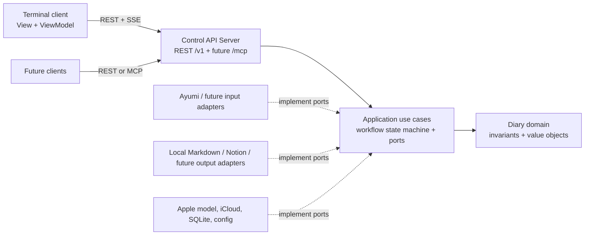

# Planned MVP architecture

Status: Proposal

The application runs a local Control API Server that owns diary workflows and
exposes them to independent clients. A terminal client is the first interface;
source and destination connectors keep diary policy independent of particular
files, cloud services, and user interfaces.

## Architectural decisions

| Concern | Decision |
|---|---|
| Client and server | A single per-user server process owns workflow state, the private database, credentials, connectors, and side effects. The TUI communicates with it over loopback HTTP like any other client. |
| Clean architecture | Domain policy and use cases depend on inward-facing types and ports. HTTP, Ratatui, macOS frameworks, SQLite, and Notion live in adapters that depend on the core. |
| MVVM | The TUI ViewModel turns API representations and event notifications into screen state; the View renders it and sends user intent back through the API client. The server remains the source of truth. |
| Pipeline | One explicit, resumable workflow state machine orders discovery, selection, composition, confirmation, and publication. Each step has typed inputs, outputs, and invalidation rules. |
| Connectors | Registered input and output connectors implement capability-focused ports. Their identifiers and opaque source or destination keys cross the API; vendor objects and filesystem paths do not become core types. |
| HTTP surfaces | `/v1` is a versioned JSON REST API with a separate Server-Sent Events (SSE) change stream. The same listener can later mount `/mcp` as an MCP Streamable HTTP endpoint; that protocol is distinct from the REST API. |

This adapts the inward dependency rule from [Clean Architecture](https://blog.cleancoder.com/uncle-bob/2012/08/13/the-clean-architecture.html)
and the adapter boundary from the original [ports and adapters description](https://alistair.cockburn.us/hexagonal-architecture).
The rule concerns source-code dependencies, not the direction of a request at
runtime. The core defines the conversations it needs; outer modules implement
them and are assembled at startup.

## System context and dependency direction



Request flow goes from clients toward the server and then through use cases.
Source-code imports point toward the domain and application boundary: domain
imports nothing outward; use cases import domain; adapters and transports import
the core. HTTP handlers translate wire DTOs and errors but do not decide source
eligibility, approve text, or infer whether a publication succeeded. The TUI
never reads the SQLite database or calls Notion or Apple model APIs directly.

Proposed Rust workspace boundaries are:

```text
crates/diary-core/              domain, use cases, ports, state transitions
crates/diary-connectors/        Ayumi, local Markdown, Notion, Apple, SQLite, macOS
crates/diary-control-contract/  versioned wire DTOs and API schema
crates/diary-control/           Control API Server, REST, SSE, future MCP adapter
crates/diary-tui/               typed HTTP client, ViewModels, views, terminal
apps/diary/                    startup, connector registry, configuration
```

The first scaffold may combine outer crates if that makes maintenance simpler,
provided `diary-core` is independently testable without a terminal, HTTP
server, Notion, Apple frameworks, or SQLite. Keep wire DTOs in the contract
module, separate from core types; server and TUI may share only that contract.
Only the process startup code selects concrete adapters. This preserves the
option to use the core from another platform with different adapters.

## Domain and application contracts

The core owns `DiaryDay`, `WritingLanguage` (`en-US` or `ko-KR`), `WritingStyle`
(`concise`, `standard`, `reflective`), `SourceRef`, `SourceSnapshot`,
`SelectionRevision`, `MemoryCandidate`, `EntryRevision`, `ConfirmedEntry`,
`OutputPlan`, and `PublicationReceipt`. A `SourceRef` pairs a connector ID with
an opaque key. An output target likewise has a connector ID and opaque target
key. IDs are stable within their connector; API clients cannot use them to
request arbitrary files or pages.

The application boundary defines small ports by purpose:

| Port | Required conversation | First adapter |
|---|---|---|
| `SourceCatalog` | Discover candidates for a bounded day query and an explicitly requested extra day. Return source references, available date evidence, warnings, and availability. | Ayumi Markdown catalog |
| `SourceReader` | Prepare only selected sources, coordinate reads, return readable text and a file identity/metadata/content-digest stamp; recheck freshness at workflow checkpoints. | Ayumi plus macOS iCloud adapter |
| `DraftAssistant` | Report runtime availability and language support; extract source-linked memories and draft from confirmed memories with bounded inputs. | Apple on-device model |
| `DraftStore` | Save and recover unfinished edits, workflow revisions, preferences, operation state, and receipts. | Per-user SQLite |
| `OutputConnector` | Inspect a destination without writing, plan its exact payload, commit, read back or reconcile an uncertain commit, and return a receipt or explicit pending/conflict result. | Local Markdown and Notion |

Ports return typed outcomes such as `NeedsDownload`, `PermissionDenied`,
`Unreadable`, `Changed`, `Unverifiable`, `Conflict`, and `AmbiguousWrite`.
Unexpected errors retain context inside the adapter but expose a safe category
and a redacted reference to clients. The core never receives Notion HTTP
responses, SQLite rows, `NSURL` values, TUI widget state, or raw front matter.
The Notion adapter obtains its credential from outer configuration; the
application ports never return or store credentials.

### Adding connectors

Register connectors at startup with a stable connector ID, display name, and
declared capabilities. Source references are namespaced by connector. When two
connectors appear to contain the same note, show both with provenance and let
the user choose; never silently merge their bodies. A source connector can
support date discovery, an explicit date jump, cloud acquisition, and freshness
verification in the ways
its medium permits. It must return immutable snapshots before its notes can be
confirmed. An output connector states whether it needs preflight, supports
read-back, and can reconcile ambiguous writes. The workflow refuses a
destination whose required safety capabilities are unavailable.

The application passes a connector-neutral `ConfirmedEntry` and destination
policy to each output adapter. The adapter first inspects the destination
without writing, then owns its payload mapping and returns the exact preview
and digest before approval. This permits a future output to
render differently while preserving one confirmed diary body. Each destination
has its own receipt and retry state; a partial failure is visible. Output
ordering and prerequisites are an explicit publication plan, not an accidental
iteration order over registered connectors. The current plan writes a local
Markdown entry first and only then attempts Notion.

Connector discovery must be bounded. The Ayumi adapter inspects only the three
directory dates `D-1`, `D`, and `D+1` for automatic discovery; another date is
read only when the user explicitly requests it. Other connectors may have
different query mechanics, but none may silently widen a search or fetch a
whole private archive to populate a screen. If a cloud-only candidate has no
readable header yet, show its directory date and unavailable header evidence;
update the proposal after selected-only acquisition and before confirmation.
The source policy uses both the
Ayumi directory date and a valid offset-aware `created_at` date as proposal
evidence. It displays disagreement and leaves inclusion to the user. See the
[input format research](research/markdown-input-format.md).

The Ayumi reader accepts UTF-8 with an optional BOM and LF or CRLF, tolerates
unknown or missing non-date metadata, and keeps a readable body selectable with
a warning if front matter is missing or malformed. Invalid UTF-8 has no
readable body. It strips supported standalone audio links and attachment paths
before text enters the core; attachment presence never changes eligibility.
The freshness digest covers original file bytes, before any text filtering.
It queries iCloud status, requests download only for selected cloud-only notes,
and coordinates those reads through a macOS adapter. [Apple's download API](https://developer.apple.com/documentation/foundation/filemanager/startdownloadingubiquitousitem(at:))
starts a transfer; a request to download is not itself proof that a readable
snapshot is available.

## Server-owned workflow pipeline

```text
choose day -> discover -> select/prepare/read -> confirm source snapshot
           -> extract memories (optional) -> review memories (optional)
           -> draft (optional) -> edit -> confirm complete entry
           -> read-only destination preflight -> plan and preview outputs
           -> approve exact plan -> local write
           -> revalidate Notion path/create/append -> read-back/receipt
```

The manual editor is available from the confirmed source snapshot and after
any model failure. Two model passes remain separate: extract source-linked
memories for human review, then draft from confirmed memories. Model output is
validated and opened in the same editor as manual text. Inferred reflections
are marked for review. The server checks Apple model availability and locale
support at runtime, as [Apple requires](https://developer.apple.com/documentation/foundationmodels/systemlanguagemodel),
and never makes model output an automatic final entry. The last language choice
is persisted; concise is the initial style. No composition text goes to a
hosted model. See [composition research](research/agent-assisted-diary-composition.md).

Every mutating transition has a workflow revision. The server checks the
expected revision before accepting a command, so simultaneous clients cannot
silently overwrite a selection, edit, or approval. Source snapshots carry
file identity, size, modification time, and content digest. Best-effort
freshness checks occur after reading, before each drafting pass, before entry
confirmation and output preview, and immediately before the first output
write. A detected change invalidates the confirmed selection, draft, approval,
and output previews. An unverifiable check blocks output until reread and
reconfirmation. Preserve unfinished user edits for recovery, but mark them
unconfirmed after invalidation. No continuous filesystem watcher is required.

The complete edited entry is confirmed before either output. An output plan
includes destination identity, rendered payload digest, and all intended
side effects. Approval binds the plan to the entry revision and selected
source digests; a changed entry, source, target, or payload requires another
preview and approval. Long-running work has a job ID, progress state, bounded
worker execution, timeout, and cancellation request. Cancelling a job cannot
undo an external write; the server reconciles its result before further
publication. The TUI event/render loop never performs filesystem, model, or
network work.

### Publication and recovery

The local adapter targets configurable
`~/Documents/narihitos-diary/entries/YYYY/MM/YYYY-MM-DD.md` and writes YAML
front matter with diary day and language plus the confirmed Markdown body. It
creates a temporary file in the destination directory, flushes it, and uses a
no-clobber finalization strategy. Same-path identical content resumes; different
content is a conflict and is never overwritten automatically. The local file
is the durable source of truth for retrying later destinations.

The Notion adapter sends only the confirmed body, without YAML front matter.
It treats the configured page as a root, resolves or creates unambiguous `YYYY`
and `YYYY-MM` child pages, and appends a `heading_2: YYYY-MM-DD` section at the
bottom of the month page. It paginates relevant reads, checks for an existing
same-day section, splits text to API limits without truncation, and reads back
the written heading and content. A matching local receipt plus matching
read-back identifies an already published entry. Conflicting same-day content
stops publication. After an uncertain page creation or append, inspect the
relevant parent or month page before retrying; never blindly replay the write.
Respect Notion `Retry-After` and bounded retry rules for rate limits. The
[Notion research](research/notion-diary-section.md) and [current rate-limit guidance](https://developers.notion.com/reference/request-limits)
support these behaviors.

The configured Notion root has not been inspected. A fail-closed, read-only
runtime preflight must inspect the root and each existing year/month path,
including pagination and permissions, before any creation or append. It shows
the path and planned changes to the user; ambiguous or incompatible structure
disables publication. Do not infer its actual layout from synthetic fixtures.
Connector acceptance also requires a disposable hierarchy for testing live
page creation. The server keeps the Notion token in an owner-only per-user
global config file, never in SQLite.

The private SQLite database under Application Support stores recoverable
drafts and versioned per-destination receipts: entry and payload digests,
selected source IDs and digests, status, relevant destination IDs, returned
block IDs where applicable, and timestamps. It stores no Notion token,
coordinates, or attachment path. Local success followed by remote failure is
reported as `local_written, remote_pending`; a later retry uses the same
confirmed entry and first reconciles the destination. No multi-destination
transaction is claimed. See [operational constraints](research/mvp-operational-constraints.md).

## Control API Server module

`diary-control` is an inbound adapter around the application use cases. It
owns HTTP routing, authentication, DTO validation, event fan-out, and safe error
mapping. The server process is the sole writer to the private database and the
only process that loads connector credentials. Its startup composition root
registers available connectors and platform adapters. Route handlers invoke
use cases; they never open source paths or construct Notion requests themselves.

The server binds only to `127.0.0.1`. It tries port `8771`, then `8772`, and
subsequent ports in a configurable bounded range; if all are occupied it fails
with a clear error. A single-instance lock prevents two writers, and an
owner-only runtime file records the chosen port and an ephemeral control token
for trusted local clients. The runtime directory is owner-only. The TUI can
start the server or attach to the registered instance, then uses the same HTTP
contract as any other client. No caller receives the Notion token through this
API. The listener does not silently widen to a network interface.

Require a bearer control token, validate `Host` and any `Origin` against the
loopback listener, reject cross-origin browser access, and disable permissive
CORS. Use different client capabilities for read, edit, approve, and publish;
untrusted or future automation clients do not gain approval rights simply by
connecting. Bound request bodies, response streams, and concurrent jobs. Do
not put credentials, diary text, source paths, or confirmation tokens in URLs,
process arguments, or logs. Any later remote access needs a separately
designed authentication and transport policy. The MCP specification itself
calls for origin validation, loopback binding, and authentication for local
Streamable HTTP servers ([MCP transport](https://modelcontextprotocol.io/specification/2026-07-28/basic/transports/streamable-http)).

### REST resources

The API uses JSON under `/v1`, stable opaque IDs, explicit schema versions,
and `Cache-Control: no-store` for private representations. `GET` is read-only;
commands use `POST`, full client-owned replacements use `PUT`, and cancellation
uses `DELETE`. Mutations of existing workflows include `If-Match` with the
current workflow ETag;
stale revisions return `412`, known conflicts return `409`, and validation
errors return typed `4xx` responses with safe messages. This follows
[HTTP method and conditional-request semantics](https://www.rfc-editor.org/rfc/rfc9110.html).

| Resource | Intent |
|---|---|
| `GET /v1/health`, `GET /v1/capabilities` | Check the server instance and list authorized connectors, writing choices, and available operations. Health reveals no diary content. |
| `POST /v1/workflows`, `GET /v1/workflows/{id}` | Start or resume a diary workflow and fetch its revisioned state. |
| `POST /v1/workflows/{id}/discoveries`, `GET /v1/workflows/{id}/sources` | Discover the bounded default window or a user-requested extra date; inspect candidates and warnings. |
| `POST /v1/workflows/{id}/sources/prepare`, `PUT /v1/workflows/{id}/selection` | Request acquisition only for selected cloud-only notes, then confirm source IDs and snapshots. |
| `POST /v1/workflows/{id}/extractions`, `PUT /v1/workflows/{id}/memories` | Run optional memory extraction and confirm or edit selected memories. |
| `POST /v1/workflows/{id}/drafts`, `PUT /v1/workflows/{id}/entry`, `POST /v1/workflows/{id}/entry-confirmations` | Run optional drafting, save manual edits, and confirm the complete entry. |
| `POST /v1/workflows/{id}/output-plans`, `GET /v1/workflows/{id}/output-plan`, `POST /v1/workflows/{id}/approvals` | Build exact per-destination previews and record an interactive approval bound to their digests. |
| `POST /v1/workflows/{id}/publications`, `GET /v1/workflows/{id}/publications` | Execute the approved plan and inspect each destination's receipt or pending state. |
| `GET /v1/jobs/{id}`, `DELETE /v1/jobs/{id}` | Observe or request cancellation of background work. |
| `GET /v1/events?workflow_id={id}` | Receive server changes over SSE; reconnect by fetching the latest workflow representation. |

An idempotency key on publication commands prevents a client retry from
starting a second local job. It does not imply that a remote Notion append is
idempotent: the Notion adapter still performs read-before-retry reconciliation.
If a response is lost, clients query the workflow or job before sending a new
command. SSE events carry event type, workflow ID, revision, job ID, and safe
progress fields; clients fetch the current representation after a missed or
reconnected stream. SSE is a notification channel, not the authority for
workflow state. The server may deliver events to multiple clients, while
revision checks preserve one canonical workflow.

### Future MCP interface

The Control API Server can mount an MCP adapter at `/mcp` on the same bound
listener and invoke the same use cases. MCP tools and resources are another
inbound transport, not a second implementation of diary rules and not a proxy
that calls the server's own REST endpoints. The route is disabled until its
capability and consent mapping is implemented and tested. Read-only tools can
expose permitted workflow status; any tool that could disclose diary text,
change selection, or publish must honor the same scoped authorization,
revision, preview, and human-approval checks. An MCP client cannot create its
own approval merely by requesting publication.

Design this route against a pinned MCP protocol revision. In the current
[2026-07-28 Streamable HTTP specification](https://modelcontextprotocol.io/specification/2026-07-28/basic/transports/streamable-http),
`/mcp` is one POST endpoint for JSON-RPC messages; each response is JSON or a
request-scoped SSE stream. That revision removed the earlier GET stream and
protocol-level sessions, so the REST `/v1/events` stream must not be described
as MCP transport or reused as its message channel. The adapter validates
required protocol metadata and origin; support for older MCP revisions needs
an explicit compatibility decision when implemented.

## TUI as an MVVM client

The TUI has one terminal owner for Crossterm setup, events, and restoration.
Views render Ratatui widgets from ViewModel state. ViewModels hold screen focus,
editor cursor and unsubmitted text, loading indicators, warnings, and the last
server revision; they map key presses into typed API commands. The typed client
handles HTTP, authentication, ETags, and SSE reconnection on bounded workers.
Server responses update ViewModels, and rendering never blocks on network,
filesystem, or model work. Persisted drafts live on the server; the TUI may
buffer unsubmitted keystrokes but does not become a second durable authority.

The selection ViewModel displays both directory and header dates, warnings,
and explicit include/exclude state. The composition ViewModel displays source
links, inferred reflections, language and style, and the full multiline
editor. The publication ViewModel displays exact destination paths and text,
pending page creation, conflicts, and per-output results. An IME indicator
uses macOS Text Input Source Services notifications, falls back to 500 ms
polling when registration fails, and shows `IME: ?` when unknown. This is
presentation-only state; it does not affect diary policy. The [TUI and IME research](research/rust-tui-stack.md)
records the compatibility and terminal constraints.
The [UX information architecture](ux-information-architecture.md) and
[terminal UX proposal](ux-gui.md) describe the screens and their behavior.

## Verification boundaries

Use invented, synthetic content in tests. Core tests exercise date proposals,
user selection, freshness invalidation, model-response validation, state
transitions, revision conflicts, approval binding, and per-destination retry
plans with fake ports. Connector contract tests exercise Ayumi UTF-8/BOM/CRLF
and malformed metadata, iCloud selected-only acquisition, local no-clobber
output, and Notion pagination and ambiguous-write reconciliation. HTTP tests
exercise unauthorized calls, origin checks, ETags, duplicate publication
commands, SSE reconnect, and multiple clients. TUI tests use an in-memory
terminal backend and a fake Control API client; a real terminal run checks
restoration and IME behavior. No test uses private diary prose or the live
Notion root.
